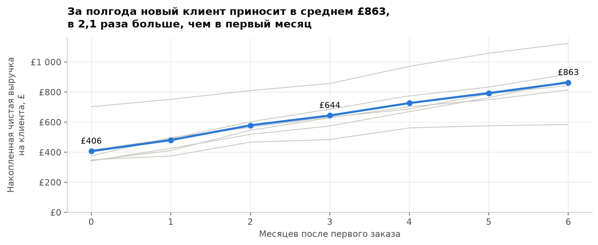
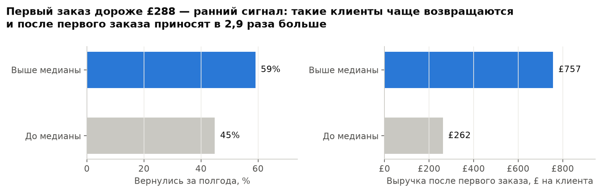
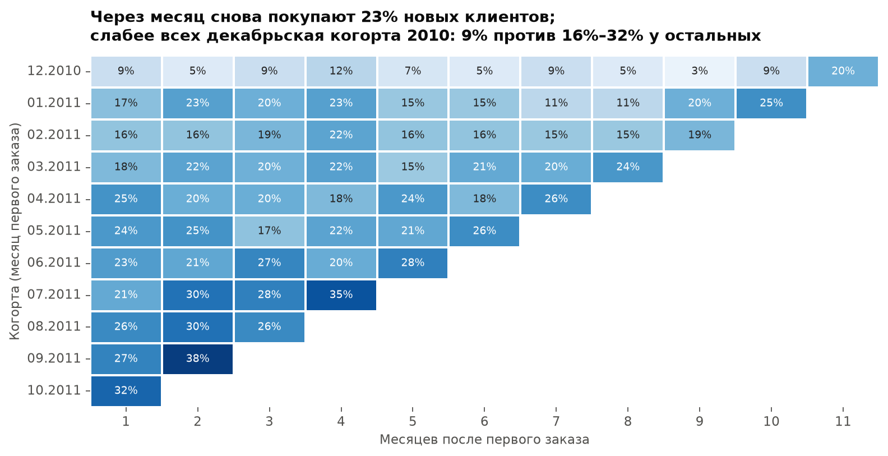
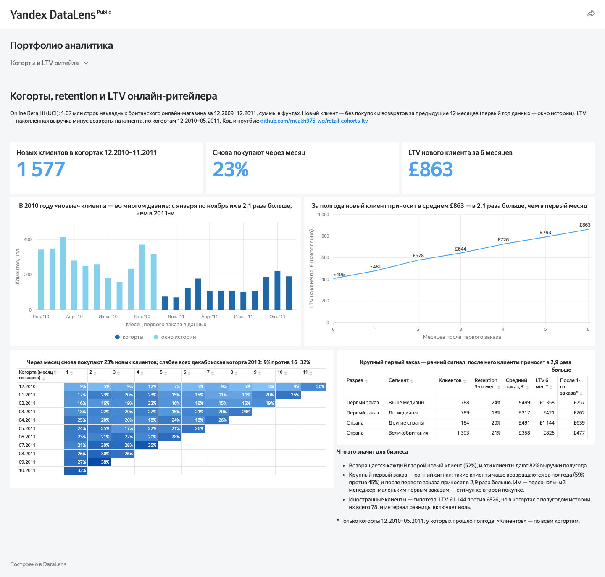
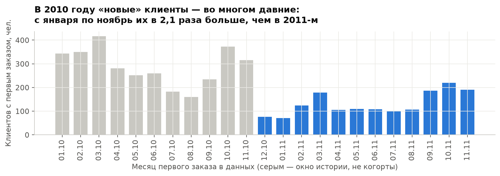

# Когорты, retention и LTV онлайн-ритейлера

[](https://github.com/mvakh975-wq/retail-cohorts-ltv/actions/workflows/ci.yml)

**Сколько приносит новый клиент за первые полгода, как часто он возвращается и по каким признакам
уже на первом заказе видно ценного клиента?** Когортный анализ на Pandas по двум годам транзакций
британского онлайн-магазина и вкладка в публичном дашборде Yandex DataLens.

**[→ Ноутбук с анализом](notebooks/cohorts_ltv.ipynb)** ·
**[→ Дашборд в DataLens](https://datalens.yandex/07arbroepa4mj?tab=retail)** (вкладка «Когорты и LTV онлайн-ритейлера»)





## Главное

1. **За полгода новый клиент приносит в среднем £863** — в 2,1 раза больше, чем в первый месяц
   (£406). Больше половины ценности приходит после первого месяца.
2. **Возвращается каждый второй.** 52% новых клиентов покупают снова в течение полугода, и на них
   приходится 82% выручки полугода: £1 377 на клиента против £316 у разовых.
3. **Сумма первого заказа — ранний сигнал.** Клиенты с первым заказом выше медианы (£288)
   чаще возвращаются (59% против 45%) и после первого заказа приносят в 2,9 раза больше
   (£757 против £262). Сам первый заказ в это сравнение не входит.
4. **Слабее всех — декабрьская когорта 2010 года:** через месяц вернулись 9% её клиентов против
   16–32% у остальных когорт. Похоже на разовых предновогодних покупателей.
5. **Иностранные клиенты — гипотеза, а не вывод.** LTV за полгода £1 144 против £826 у британских,
   но клиентов всего 78, и 95% бутстрап-интервал разницы [−£36; £768] включает ноль.

**Что делать:** после крупного первого заказа подключать персонального менеджера или условия для
постоянных клиентов; маленькие первые заказы стимулировать к повтору (скидка на второй заказ);
сегмент иностранных клиентов проверить на следующем периоде.



## Дашборд

Те же выводы в интерактивном виде — [вкладка «Когорты и LTV онлайн-ритейлера» в DataLens](https://datalens.yandex/07arbroepa4mj?tab=retail):



## Данные и главная ловушка

[Online Retail II](https://archive.ics.uci.edu/dataset/502/online+retail+ii) (UCI; файлы скачиваются
с [зеркала на Kaggle](https://www.kaggle.com/datasets/mashlyn/online-retail-ii-uci)): 1 067 371 строка
накладных за 01.12.2009–09.12.2011, большинство клиентов — небольшие оптовые покупатели.
Очистка — [`src/clean.py`](src/clean.py), решения по каждой проблеме —
[`docs/data_quality.md`](docs/data_quality.md): строки без клиента (13,7% выручки), дубли,
сервисные коды (доставка, комиссии), возвраты.

**Кого считать новым клиентом.** Данные начинаются в декабре 2009, но магазин работал и раньше.
Давний клиент, который заказывает раз в квартал, «впервые» появляется в данных весной 2010
и выглядит новым: с января по ноябрь 2010 года таких «новых» в 2,1 раза больше, чем за те же месяцы 2011-го. Поэтому первые 12 месяцев —
окно истории, а новым считается клиент без покупок за предыдущий год. Клиент, у которого возврат случился раньше первой покупки, тоже давний и в когорты не входит.
Остаются 1 577 клиентов в 12 когортах: декабрь 2010 — ноябрь 2011.



## Определения

- **Когорта** — месяц первой покупки. Возврат (накладная на `C`) покупкой не считается.
- **Retention месяца N** — доля когорты с покупкой через N месяцев после первой.
- **LTV** — накопленная чистая выручка (покупки минус возвраты) на клиента когорты, без учёта маржи.
- **Сопоставимые когорты** — средние по месяцам жизни считаются только по когортам, у которых
  есть полгода истории (12.2010–05.2011, 663 клиента): иначе средние искажает состав когорт.
- Неполный декабрь 2011 в расчёты не входит.

## Как устроено

```
Kaggle CSV ─► scripts/download.py ─► data/raw/                 (не в git)
           ─► src/clean.py           строки → накладные клиентов, отчёт об очистке
           ─► src/cohorts.py         когорты, retention, LTV, сегменты (pandas)
           ─► notebooks/cohorts_ltv.ipynb   анализ и графики (Matplotlib, Seaborn) → docs/
           ─► scripts/export.py ─► data/datalens/*.csv ─► дашборд DataLens
```

Логика когорт покрыта тестами (`tests/`) на маленьких таблицах с посчитанными вручную ответами:
возврат не считается активностью, неполный месяц не входит, первый месяц данных не когорта,
при одинаковом времени двух заказов «первым» всегда считается один и тот же.

## Как запустить

Нужны [uv](https://docs.astral.sh/uv/) и аккаунт Kaggle (`uv run kaggle auth login`).

```bash
uv sync
make data       # скачать CSV
make notebook   # выполнить ноутбук: графики в docs/, агрегаты в data/datalens/
make test
```

## Лицензия

Код — MIT. Данные Online Retail II и производные файлы в `data/datalens/` — CC BY 4.0
(см. [`DATA_LICENSE.md`](DATA_LICENSE.md)).
